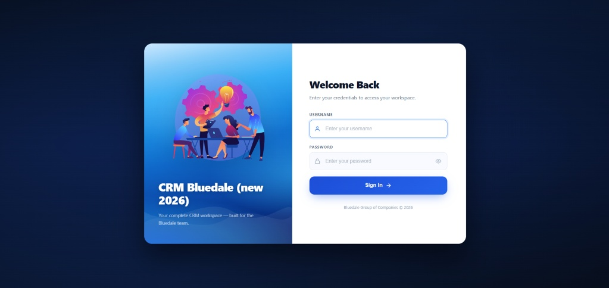
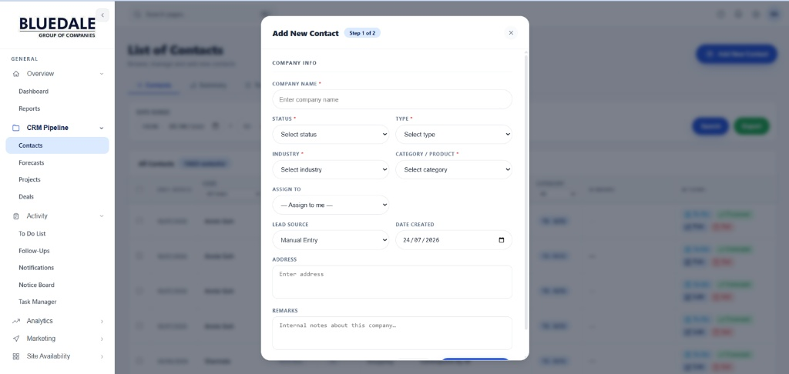

# Library CRM v2 (Bluedale Group of Companies)

A production-grade, multi-user Customer Relationship Management (CRM) system built for managing contacts, sales pipelines, forecasting, tasks, follow-ups, and marketing operations. Engineered as a complete end-to-end solution with a Laravel 13 backend API and a reactive Vue 3 SPA frontend.

---

## UI & Interface Design

> **Note:** The UI prioritizes clean data visualization, responsive layouts, and progressive disclosure to handle high information density across three distinct permission tiers without visual clutter.

### Authentication

*A clean, modern authentication gateway for the Bluedale CRM workspace.*

### Progressive Disclosure

*Step-by-step modal forms keep the user in the context of their current task without requiring full-page reloads.*

---

## Architectural & Design Decisions

* **Progressive Disclosure:** To prevent cognitive overload on data-heavy reporting screens, complex filters and administrative tools are hidden behind clean, semantic dropdowns and modals until explicitly needed by the user.
* **Unified Role-Based Layout (Spatie RBAC):** Instead of building entirely separate portals, the interface uses a single, unified layout that dynamically strips away unauthorized navigation links and data columns based on backend middleware permissions.
* **Reactive Client State:** Vue 3 (Composition API) is leveraged for complex DOM manipulations and asynchronous state changes, eliminating full-page reloads during high-volume data entry and ensuring a snappy, application-like feel.
* **Multi-Database Architecture:** The system manages concurrent connections to a primary MySQL database (port 3307) for new CRM operations while seamlessly interfacing with two read-only legacy databases (port 3306) to maintain historical data continuity.

---

## Tech Stack

- **Backend:** Laravel 13, PHP 8.3+, Sanctum token auth, Spatie RBAC
- **Frontend:** Vue 3 SPA (Composition API), Vue Router 5, Axios, Chart.js
- **Database:** MySQL (Primary on port 3307) + two read-only legacy DBs (port 3306)
- **Build:** Vite 8

---

## User Roles

| Role | Access |
|------|--------|
| `super-admin` | Full access including user management and RBAC. |
| `admin` | Full access including team performance metrics and administrative panels. |
| Regular user | Scoped access to own contacts, todos, follow-ups, deals, and forecasts. |

---

## Quick Setup

```bash
# 1. Install dependencies
composer install
npm install

# 2. Configure environment
cp .env.example .env
php artisan key:generate
# Edit .env — set DB_* values (see .env.example comments for the multi-DB setup)

# 3. Run migrations and seed reference data
php artisan migrate
php artisan db:seed --class=RolesAndPermissionsSeeder

# 4. Start all services (Laravel + Vite HMR + queue + log tail)
composer run dev
